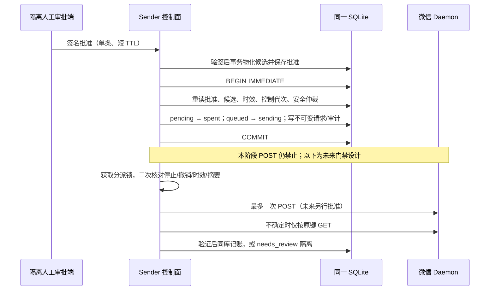

# ADR-0001：单条人工批准、同库认领与可信回执绑定

- 日期：2026-11-22。
- 文档状态：**PROPOSED**；设计与离线可行性验证，不是部署批准或真实发送授权。
- 范围：交接任务 B。当前生产 POST 禁令、配置、服务、schema v4 和 Cursor 均不变。
- 单条批准设计用于人工控制的发送测试。正式自动回复按第 14 节运行，无需操作者逐条确认。
- 前置证据：[固定版本协议审计](agent-wechat-v2.9.0-protocol-audit.md)、
  [合成原子事务实验](P6.5D2D2B2-atomic-claim.md)。

## 1. 问题与现有代码约束

1. Consumer/Worker 的配置验证要求 `false/false/true` 观察开关，而
   `outbound_safety._config_permits()` 要求相反开关。不能复制并伪造旧配置来绕过检查。
2. Worker / `process_one()` 仅保存 `proposed` 决策，没有调用 `accept_decision()` 或
   `enqueue()`。现有 Outbox 为空，审批流程还需要一个受控的候选物化入口。
3. `Storage.claim_outbox_for_send()` 已在 `BEGIN IMMEDIATE` 中调用安全仲裁；
   但没有可信批准。`record_send_result()` 仅接受 `sending`，不能直接处理
   已隔离为 `needs_review` 后才查到的成功结果。
4. 真实 v2.9.0 回执不回显正文或幂等键。同键查询的可信来源和不可变本地请求绑定
   必须取代合成检查器的回显假设，不能向远端对象补造字段。
5. `Storage` 和 `sender_dry_run` 硬编码 schema v4；`send_attempts` 现有定义只有
   `attempt_id/outbox_id`，不能假定它已具备完整审计能力。
6. scheduled task 触发器不允许 `needs_review -> sent`。对账还需同步 Outbox 与任务状态，
   不能仅更新一张表或绕过触发器。

## 2. 威胁模型与推荐方案

保护对象：明确的操作者批准、账号/群/正文、一次性额度、发送 Token、未决状态和审计链。
不信任群消息、模型输出、候选展示数据、导入 JSON、回执和可编辑的 Sender 策略。

**推荐：本机 CLI 审阅 + 独立审批身份持有 Ed25519 私钥 + 独立 Sender 身份持有发送凭据。**
使用已安装的 OpenSSH `ssh-keygen -Y sign/verify`，无需引入 Python 密码学依赖。
它支持签名命名空间、签名身份及允许签名者文件，见
[OpenSSH 官方手册](https://man.openbsd.org/ssh-keygen#Y)。

角色及部署边界是未来方案，当前没有创建账户、密钥、ACL 或生产配置：

| 角色 | 允许 | 不允许 |
|---|---|---|
| Consumer/Worker | 事件持久化、受限模型决策；继续使用原观察配置 | 读取批准私钥或 Sender Token、自动批准 |
| 人工审批身份 | 在可信终端检查准确目标和正文，签署 approve/revoke/stop 等明确动作 | 后台无人值守签名、空白或批量发送批准 |
| Sender 身份 | 验签、同库认领、对账；将来只在批准门禁下读取独立 Token | 持有批准私钥、把 enabled 当批准 |
| 管理员部署边界 | 安装不可被机器人改写的可执行代码、公钥信任配置和控制状态 | 从可写开发目录直接运行持有生产发送 Token 的代码 |

私钥不能放在机器人能读的位置，也不能交给该 UID 可访问的 ssh-agent。
公钥非秘密，但信任配置、解释器/可执行文件及其父目录必须禁止机器人修改。
部署前需实际验证账户切换、sudo、ptrace、组权限和服务配置；本阶段没有验证这些隔离。
独立 Sender 还需要经批准迁移/轮换现有同 UID Token，避免历史副本继续有效。
还需盘点 Native Daemon 的 owner Token 和其他具有 send/admin 权限的凭据：只隔离项目
Sender Token，而仍让非受信自动化读取 owner Token，不能形成完整发送权限边界。
本阶段未读取或审计这些凭据的内容与托管情况，不假定它们已经隔离。

**边界：** `0600`、TTY、输入确认词或同 UID 的签名密钥都不能单独证明操作者是真人。
同 UID 可写信任文件也能替换受信公钥，离线测试专门演示这一点。
共享 SQLite 的所有写入程序仍须可信；本方案不承诺抵抗任意恶意主库写入/回滚、
root 或已被攻陷的 Sender。若将任意数据库写进程也列为攻击者，必须另行设计受控数据库
写入代理/权限架构，不能把 SQLite 的文件权限误称为表级隔离。

不采用同 UID HMAC（验签者可自行伪造）、网页后台或复杂审批服务。
硬件签名或另一台设备可作为后续更强的托管选项；不在本次开发中自动部署。

## 3. 人工审阅与候选物化

以下命令名仅表示未来接口，当前没有可执行生产入口：

1. `review preview <decision-id>` 只读展示：准确账号/群、完整最终正文、来源、
   消息年龄、固定激活边界、正文与请求摘要、有效时间；不调用模型、不写库。
2. 审阅端对 ANSI/控制符及双向文本等展示歧义显式转义/拒绝，不把正文当指令执行。
   摘要始终绑定原始 UTF-8 正文，不做 trim、Unicode 归一化或隐藏的模板修改。
3. 操作者通过隔离身份认证后，输入包含短摘要的明确确认词，再签署一个目标的一次批准。
   TTY 和确认词只是防误操作；认证来自隔离的操作者会话与密钥托管。
4. 导入端重新读取候选，验证签名、全部绑定和时效；在一个事务中接受决策、物化 Outbox、
   保存批准及审计。预览后发生任何变动均拒绝，不静默重签或改写目标。
5. 物化不等于认领或发送。仍需独立 Sender 开关、未暂停状态、未决阻塞、冷却和单次认领。

Outbox ID 沿用 `Storage.enqueue()` 基于 decision ID 的确定性规则。首轮生产准入仅接受
尚未物化的新候选：审阅时在审批身份的私有草稿中生成至少 128 位随机的专用幂等键，
签名后在导入事务中首次固化；草稿生成不写生产数据库，也不产生发送权限。
旧 enqueue API 的默认 UUID5 键保持不变，但旧候选不自动纳入这一首轮准入路径。
不重写任何已有 Outbox 的键；尤其禁止为未决发送换键。冲突草稿只允许首个导入，后者拒绝。
未来应抽取事务内可复用的 helper，保留旧 API，不嵌套调用已有会自行 BEGIN 的方法。
仅物化激活边界之后、仍新鲜的已批准候选，不能生成历史补发任务。
第一轮只计划 AI 文本回复；签到/定时任务继续停用，未来也必须逐条绑定日期、内容和来源。
当前 Worker 停用时不会出现新的 AI 候选；本方案不会为验收启动它或调用线上模型。

## 4. 签名信封与验证规则

批准签名命名空间固定为 `wx-chat-bot-approval-v1`；控制动作使用
`wx-chat-bot-control-v1`，不得交叉使用。

| 签名字段 | 约束 |
|---|---|
| schema_version / action | 固定版本、固定 approve 动作；拒绝未知字段和动作 |
| environment_id / control_epoch | 受保护的安装实例和控制代次；不得从导入文件自设信任根 |
| approval_id / actor_id / key_id | 随机唯一批准 ID、受信身份及实际验签公钥指纹；不信任自报身份 |
| account_id / thread_id / outbox_id | 精确目标及候选身份，与白名单和持久化行逐项匹配 |
| source_kind / source_id / source_cursor / activation_cursor | 绑定原始决策/任务；AI 消息 cursor 必须严格晚于激活边界 |
| idempotency_key | 绑定固定目标账号和同一发送请求；遵守 200 ASCII 字节合同 |
| content_sha256 / request_sha256 | 正文 UTF-8 字节摘要、最终 HTTP 请求 body 精确字节摘要 |
| issued_at / expires_at | UTC 整数秒；默认 TTL 60 秒，范围 1–120 秒，issued <= now < expires |
| max_sends | 必须是整数 1，bool/浮点数/字符串/批量额度均拒绝 |

信封采用 `ensure_ascii=True, sort_keys=True, separators=(',', ':'), allow_nan=False`
的固定 JSON 字节表示；验签绑定这些确切字节，导入同时拒绝重复键、过大输入和非规范表示。
建议上限 16 KiB；只保存正文摘要，不在信封中保存聊天正文。
HTTP body 使用当前构造器的确定性 UTF-8 编码，签名端和发送端必须使用相同版本。

签名仅证明密钥对这些字节签过名：不能证明一次性、TTL 合法、候选新鲜或真人已审阅。
生产导入/认领需各自验证所有语义；私钥或批准文件不得写入日志。
生产时钟来自可信系统时钟，不接受信封提供 now。时钟倒退、未来签发或控制代次异常时暂停；
重启/数据库恢复不能借此重新激活旧批准。审批 TTL 不延长原有 120 秒消息/决策时效。

## 5. 数据模型与事务图（拟议，尚未执行）

在同一主数据库增加以下表，不创建第二个授权数据库：

| 表 | 关键内容与不变量 |
|---|---|
| sender_approvals | 批准 ID 主键、Outbox 外键、原始规范信封/签名、受信 key_id、expires_at、状态及独立 revoked_at；每个 Outbox 仅一个批准，终态不可复用 |
| sender_dispatch_intents | 每个 Outbox 唯一请求，绑定批准、目标/正文/请求摘要、幂等键、部署/控制代次及远端 ID；核心字段不可变 |
| sender_control | 当前代次和暂停状态在主库的投影；不能推翻库外受保护的停止状态 |
| sender_audit_events | 批准、撤销、认领、对账和人工处置的关联 ID、固定事件码、时间和摘要；不含正文/Token/原始身份 |

`send_attempts` 暂不擅自改义；未来迁移时需先盘点真实 schema，选择兼容扩展或与新审计表关联。
同一审批 ID/候选/幂等键唯一性、外键及不可变触发器阻止常规代码误用；不宣称能抵抗恶意库所有者。



许可消耗、候选认领、不可变请求和认领审计必须在同一 `BEGIN IMMEDIATE` 内提交/回滚。
验签可先完成耗时工作，但事务内重读字节和摘要、信任/撤销/控制状态，不能用事务前快照直接认领。
网络不在 SQLite 事务内；锁冲突有界失败，不转而绕过 Storage。
事务提交后批准始终 spent，不能因网络失败或“看起来没发”退回 pending。

## 6. 角色配置与现有安全仲裁的兼容方式

保留原共享观察配置和旧 `claim_outbox_for_send()` 调用行为，不构造反向开关的假 config。
未来显式引入“观察配置验证”和“独立 Sender 运行策略”两种类型/入口：

- Sender 策略只是额外的角色门禁，默认 disabled；本机控制状态默认 stopped，文件缺失也拒绝。
- 从 `dispatch_block_reason()` 提取/复用同一份来源、白名单、时效、冷却、未决及最新候选规则；
  在正式仲裁入口加入明确的受信角色上下文，不允许存在绕过公共仲裁的第二条路径。
- 通过 `Storage` 的显式授权认领接口检查原观察状态、签名批准和 Sender 控制面；
  调用公共安全仲裁后再执行原子转换。旧接口继续拒绝观察配置下的发送。
- 事务内额外核验 source cursor 严格晚于受信激活边界；当前公共仲裁不提供完整激活边界校验。
- `enabled=true`、已接受决策、queued 行或审批签名中的任何单项都不构成可发送能力。

## 7. 撤销、紧急停止及崩溃边界

批准状态：`pending -> spent / revoked`；过期可派生或记录为终态，不存在重新批准同一候选的自动路径。
撤销 pending 在同库事务中生效；已 spent 的撤销只阻止尚未开始的新分派，不能恢复额度。
已 spent 的撤销记录独立 revoked_at，保留 spent 状态；撤销确认同样等待分派锁，
不能承诺抢回确认前已开始的网络请求。

全局停止由受保护控制端先持久化 stopped 状态并推进 epoch，再等待 Sender 的同一分派锁，
最后提交主库投影和审计后确认。状态缺失、不一致或导入中断均保持停止。
恢复必须是新的明确人工控制动作并再次推进 epoch，旧批准全部失效；不能自动解除暂停。
控制面不依靠两库提交来消耗许可，库外停止状态只作额外拒绝条件。

**保证边界：** 分派锁涵盖发送前检查和一次有界网络调用；停止确认之后不会开始新的 POST。
检查后、停止确认前已经开始的请求可能完成；Daemon 已接受的 queued 任务仍可能稍后发送。
本地停止不能撤回这些远端任务，不自动调用取消、撤回或换键重发。
离线认领后进程崩溃无法证明是否执行过 POST，继续 spent，并进入同键只读对账/隔离。

## 8. 无正文回显时的对账合同

对账至少绑定：不可变本地请求 + 已消耗批准 + 固定 Daemon 身份 + 固定账号下原键 GET。
查询 URL/键来自受保护的已提交请求，不从候选展示数据、回执或模型输出派生。

- 最小权限 Token 只用于批准的本机 Daemon；禁止代理/重定向和任意 URL。
- 核对响应类型、账号、`destination`、远端 send ID、状态、可用的 serverId 和一致性。
  初次确立的远端 ID 不得在后续查询中改变；`queued/submitting` 不是 sent。
- 仅有 `accepted` 或已存在的 serverId 不足以证明正文。请求绑定还依赖可信 Sender、
  不可变请求记录、不可预测且专用的键，以及已审计的同键请求语义。
- 当前确定性 UUID5 键虽稳定但不是秘密，不能当作请求证明。首轮新候选使用第 3 节的
  专用随机键，并核验完整本地来源与发送凭据边界；随机性本身也不是批准。
  首轮无 POST 的门禁实现继续返回“需要对账”，不自动放宽现有合成检查器。
- 在生产成功回执尚未验收前，原生 `accepted` 自动记 sent 仍关闭。
  将来如用 `localMessageId` 查询本地投影来加强正文核对，须先证明该 GET 不下载/刷新或写库；
  不能直接调用现有会持久化数据的 hydration 路径。
- 404、过期、超时、非 JSON、未知状态或身份不符均不能证明未发送；保持 needs_review，阻塞同群后续。
- 已 needs_review 后查到可信成功，需要专门、受审计的事务接口，保持原键和批准 spent，
  同时更新 Outbox/任务/审计。它不能再要求批准仍未过期来记账，也不能据此授权重新 POST。

生产绑定方式及单条成功回执仍是未来上线门禁，不因本 ADR 或合成测试而自动通过。

## 9. 威胁/故障与验收矩阵

| 情形 | 必须结果 | 当前证据 |
|---|---|---|
| 任一签名字段被改、非受信键/身份、审批与控制签名混用 | 拒绝 | 新增 OpenSSH 临时密钥测试 |
| 同 UID 可改信任文件 | 明确不可信，禁止据此部署 | 新增反例测试证明 0600 不足 |
| 有效签名被重放、签了不合法 TTL/额度 | 仍需语义与数据库门禁 | 新增反例；完整生产解析器待实现 |
| 过期、撤销、急停、错目标、并发、两次更新间崩溃 | 无部分认领/无复用 | 现有 D2D-2B2 临时数据库实验 |
| 预览后正文改变、历史源、冷却或未决阻塞 | 认领失败 | 既有 outbound_safety；正式集成测试待实现 |
| 认领提交后、POST 前或响应丢失时崩溃 | spent 保留；不重发；同键对账 | 既有合成事务/HTTP 实验；生产绑定待实现 |
| 202 / queued / submitting / 无回显 accepted | 不自动标记成功 | 既有原生合同兼容测试 |
| key 泄漏、时钟倒退、库回滚、控制代次变化 | 停止；失效旧批准；审计处置 | 设计要求，未部署验证 |
| v4/v5 reader、任务 needs_review 对账、权限/服务隔离 | 兼容且失败关闭 | 未来迁移与系统测试，不宣称通过 |

## 10. 迁移、权限与回滚计划（只设计）

建议下一 schema 版本为 v5，但当前不创建迁移或生产表：

1. 先在临时 v4 库实现 additive DDL、约束和 schema 精确检查；新代码须兼容
   v4 观察路径与 v5 扩展路径。同步更新 Storage、只读诊断和相关版本断言，禁止任意放宽版本。
2. 测试 Reader/Consumer/Worker 的 v5 启动兼容，旧接口继续拒绝发送；
   测试任务状态触发器在经过验证的对账路径中一致迁移，不允许通用重置状态。
3. 设计主库在 Consumer 与隔离 Sender 间的最小共享组/ACL、父目录、SQLite journal/WAL/SHM
   权限与安全打开策略。当前服务 UMask=0077 等设置不能假定跨 UID 可用，需另行审批并验证。
4. 用户明确批准后，才部署受保护代码/信任根/独立身份，轮换 Token 并迁移权限；
   服务仍 disabled、策略 disabled、控制 stopped，不自动切换安全开关。
5. 生产迁移需另一份明确批准：停所有 bot 写入进程（不无故停 Native Daemon），
   做 SQLite backup、校验恢复和权限，再事务迁移、核验记录/触发器/完整性。
6. 默认回滚是停止 Sender，保留 additive schema 和兼容 Reader；禁止发送后恢复旧库来抹去
   spent/未决记录。只有无后续发送、无新增接收写入且经批准的情况下才可考虑整库恢复。
   任何恢复都推进受保护 epoch、废弃旧批准，先对账后恢复人工操作。

## 11. 审计、密钥轮换与泄漏恢复

一般日志只含随机批准/审计关联 ID、固定原因码、时间、请求摘要及受信部署版本。
账号/群/正文不出现在一般日志；正文摘要也属于敏感元数据，不对外公开。
签名信封因含目标标识须私有保存、限制留存；公开证据只能使用合成数据。
同库审计可检测普通流程错误，但不是对恶意库所有者不可篡改的账本。
如需更强证据，可将脱敏事件另存受保护的系统日志；它不能取代同库认领事务。

轮换先停止并推进 epoch，再更新管理员控制的允许签名者配置；旧键的 pending 批准失效，
spent/未决记录继续保留并对账。私钥泄漏时先撤销签名信任；Sender Token 泄漏时还需
显式批准撤销/轮换 API 凭据，删除私钥文件本身不能撤销已泄漏的 API Token。
恢复不重签旧候选、不自动解除暂停；不声称同 UID 权限即可发现所有泄漏。

## 12. 本阶段验证与下一最小任务

新增 `tests/test_sender_approval_design.py`：用新建临时 Ed25519 密钥验证签名字段绑定、
受信身份、命名空间隔离、签名损坏，以及重放、非法额度/时效、可写信任根的反例。
这些是工具/设计可行性实验，不是生产批准导入器，不证明跨 UID 隔离或真人在场。
现有 D2D-2B2 提供可运行的同库临时数据库事务验证；未额外创建平行生产授权库。

```bash
PYTHONDONTWRITEBYTECODE=1 PYTHONPATH=src /usr/bin/python3 -m unittest discover -s tests -p 'test_sender_approval_design.py' -v
PYTHONDONTWRITEBYTECODE=1 PYTHONPATH=src /usr/bin/python3 -m unittest discover -s tests -p 'test_sender_atomic_approval_fixture.py' -v
PYTHONDONTWRITEBYTECODE=1 PYTHONPATH=src /usr/bin/python3 -m unittest discover -s tests -q
```

实际结果：Ubuntu Python 3.14.4、OpenSSH 10.2p1；新增专项 **12/12**（0.216 秒），
全量 **386/386**（2.186 秒，无跳过），即原有 374 项加新增 12 项。
全量包含 D2D-2B2 的 26 项临时数据库测试；未单独重复执行上述第二条命令。
`compileall` 通过，字节码写至 `/tmp/wx-approval-design-fp27bnoj/pycache`。
这些成绩覆盖签名原语和已有实验，不代表拟议数据模型、生产验签器或跨 UID 部署已实现。

只新增本 ADR 和设计测试；60 个既有文件的 SHA256 全部保持一致。
没有读取真实 Token、执行生产 POST/线上模型、改动服务或配置、写入生产库或执行迁移。
临时签名密钥由测试创建并随私有临时目录清理，不安装到任何生产信任目录。
2026-11-22T02:35:45Z 收尾只读检查：`NO_CANDIDATES`，所有 Outbox 状态和其他目标计数均为 0；
Sender 策略不存在；激活 Cursor `41030`；观察开关仍为 `false/false/true`。
Consumer/Native Daemon 为 `active/enabled`，Worker 为 `inactive/disabled`。
本阶段回滚仅撤回这两个新增文件并先检查后续引用，无需回滚生产状态。

## 13. 离线批准信封验签实现

`sender_approval_envelope.verify_approval_envelope()` 接收规范 JSON 字节、OpenSSH 签名、
独立取得的候选、当前时间、受信身份和固定 Ed25519 公钥。
v1 使用小写 UUIDv4 hex 作为 `approval_id`，`send-` 加 32 位小写 hex 作为幂等键，
并以 OpenSSH `SHA256:` 指纹作为 `key_id`。键的随机性由未来草稿生成器负责。
验签信任条目由显式传入的身份和公钥构造，签名文件与信任条目存放在同一私有临时目录。
正文使用共享的 HTTP 编码器计算请求摘要，避免两处序列化产生不同字节。

验证结果是一次证据检查，`live_send_authorized` 固定为 `false`。调用方应从受保护的配置
和持久化候选取得参数。未来 Storage 事务负责重新检查时效与撤销、消费批准并阻止重放。
当前检查器支持 AI 文本审批，控制签名与定时任务审批没有接入。

```bash
PYTHONDONTWRITEBYTECODE=1 PYTHONPATH=src /usr/bin/python3 -m unittest discover -s tests -p 'test_sender_approval_envelope.py' -v
PYTHONDONTWRITEBYTECODE=1 PYTHONPATH=src /usr/bin/python3 -m unittest discover -s tests -q
```

Ubuntu Python 3.14.4 上专项 **9/9**、全量 **395/395** 通过，`compileall` 通过。
专项使用临时密钥及由现有迁移构建的临时 v4 SQLite，覆盖错误密钥和命名空间、
规范编码、时效、作用域与摘要，以及签署后候选更改。生产入口和持久化状态转换属于后续集成。

## 14. 自动回复授权范围

用户要求机器人在自动回复模式下自行决定是否回复。上线时由用户一次明确授权指定账号、群和回复规则。
在授权保持有效期间，每条符合规则的回复可自动入队、认领和发送，无需点击确认、签名或生成逐条批准记录。
扩大范围或启用生产模式仍需明确授权。单条真实发送测试沿用交接任务 E 的单独授权。

自动路径读取受保护的独立 Sender 策略，记录策略版本与控制代次。认领时在同库事务内核对策略、
白名单、来源与正文、激活边界、候选时效、群冷却、最新候选规则和未决记录，再写入不可变请求与认领审计。
发送前再次检查策略和急停。每个候选仍只有一个持久化幂等键和一次认领机会。
策略缺失、禁用、过期（如设窗口）或代次变化时停止新发送。已有未决请求继续用原键只读对账。

任务 D 的离线验收应覆盖以下行为，生产 POST 继续由现有门禁阻止。

- 策略有效且候选合格时，在没有批准信封或逐条人工批准记录的情况下完成离线认领。
- 策略缺失、目标越界、候选过时、冷却未结束、存在未决发送或触发急停时，拒绝认领或分派。
- 并发、崩溃或重启不产生重复发送机会，审计记录能区分单条人工授权与策略授权。

策略认领、v5 迁移备份和合成回执对账的代码及验证入口见 [自动回复离线验收与上线条件](automatic-reply-release.md)。
